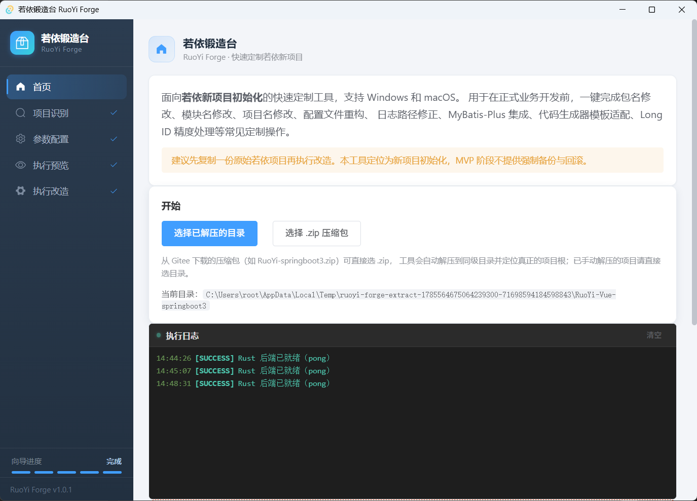
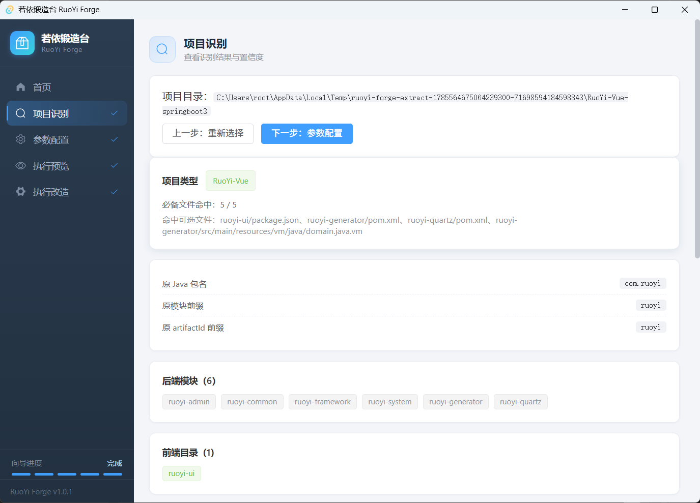
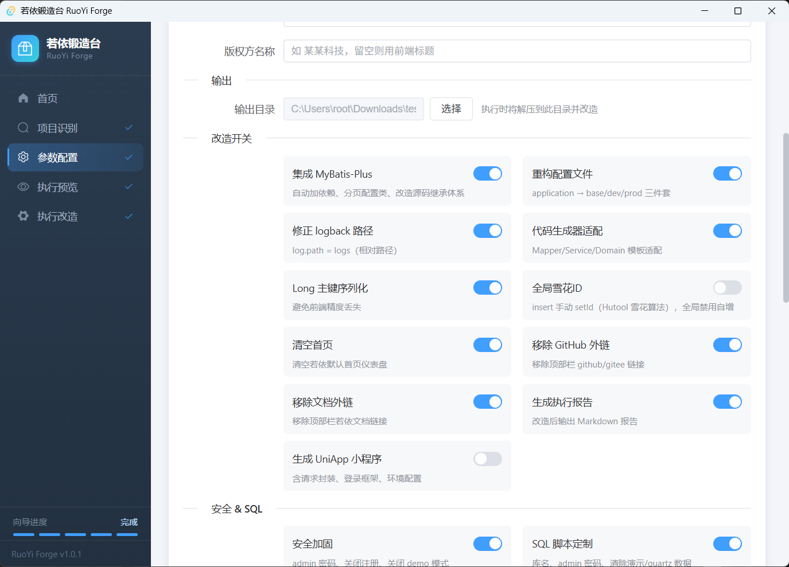
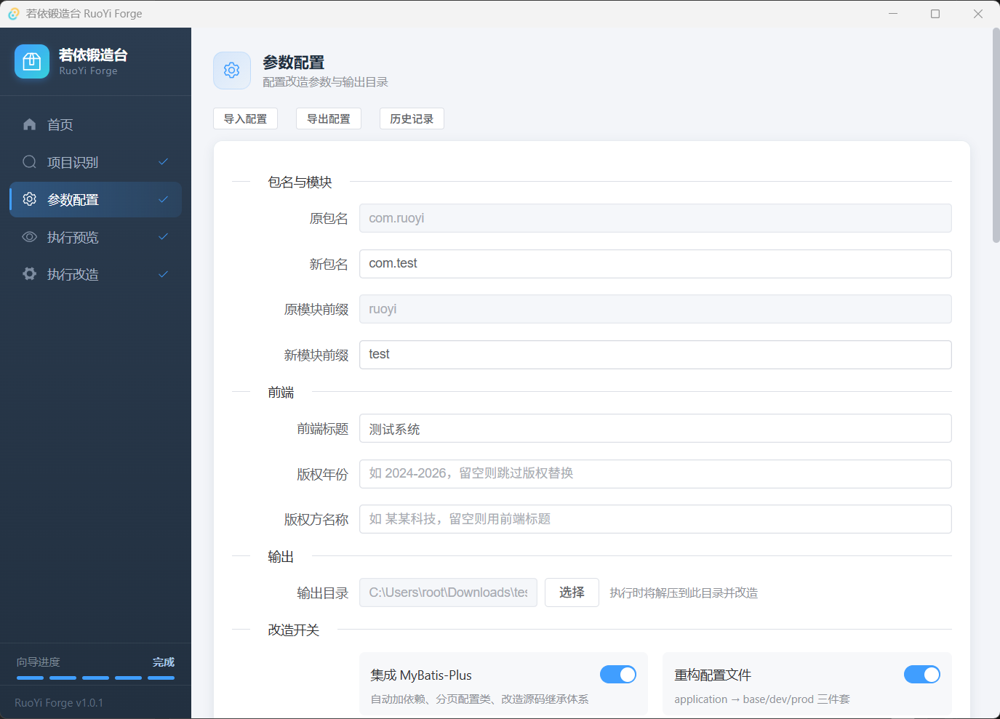
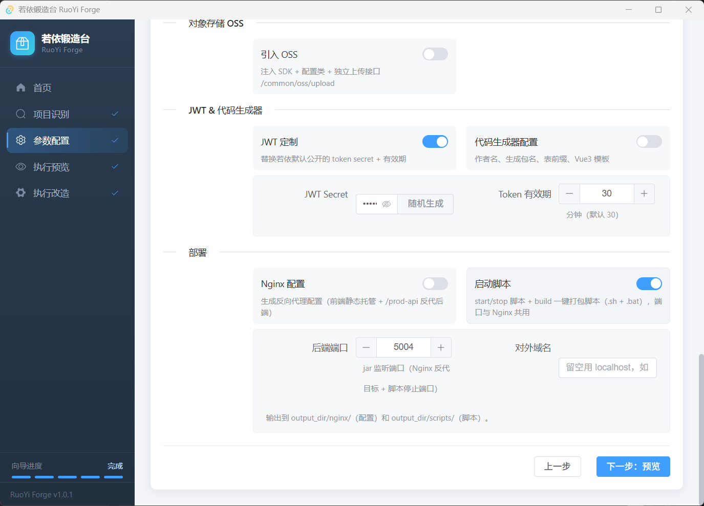
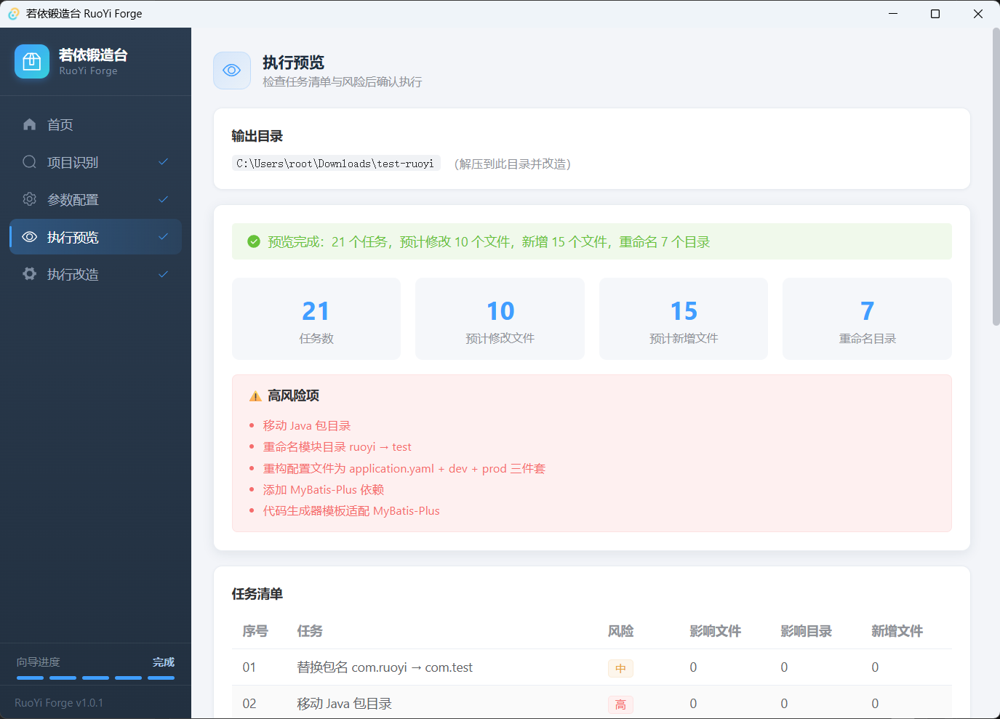
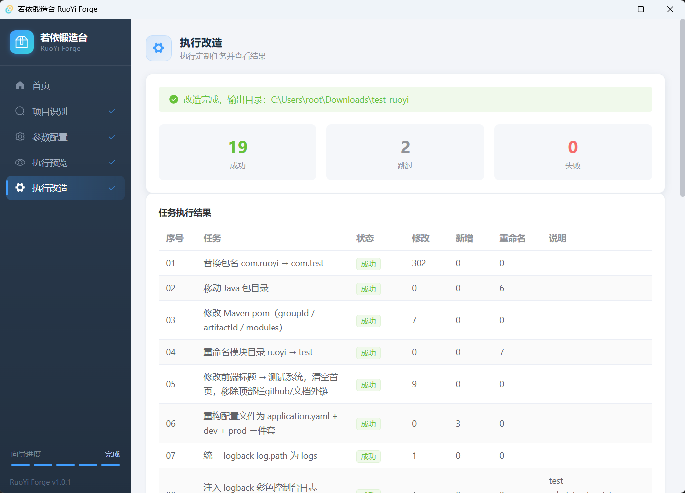

# 若依锻造台 RuoYi Forge

[English](README.en.md) | 中文

若依新项目的快速初始化定制工具，同时覆盖 **RuoYi-Vue 前后端分离** 与 **RuoYi-Cloud 微服务**（官方仓库可从首页拉取）。一键完成包名修改、模块重命名、配置文件重构、MyBatis-Plus 集成、UniApp 小程序骨架生成等常见定制操作，告别重复劳动。

> 本项目基于 [GLM 5.2](https://zhipuai.cn) 协同开发。

---

## 功能特性

- **包名改造** — Java 包名全文替换 + 目录自动迁移
- **模块重命名** — 后端模块 + 前端目录统一按前缀替换（如 `ruoyi-admin` → `demo-admin`）
- **Maven 坐标修改** — groupId / artifactId / modules 依赖引用批量替换
- **配置文件重构** — 分离版将 `application.yml` + `application-druid.yml` 改为 `application.yaml` + `application-dev.yaml` + `application-prod.yaml` 三件套；Cloud 改写 Nacos `sql/ry_config*.sql`，不生成 application.yaml 三件套
- **RuoYi-Cloud** — 改写 Nacos 数据源 / Redis / Token、各微服务端口（含 bootstrap.yml）；Redis 连接、上传物理路径、`demoEnabled`、Nacos 地址与命名空间均可配（默认零改动）；可裁剪 gen / job / file / monitor；替换 UI 时叠加 cloud-overlay（登录 `/auth/login`、任务 `/schedule/**`、代码生成 `/code/**`、日志 / 在线等）；可新增业务模块短名（仅 Cloud），生成 `{prefix}-modules/{prefix}-{name}` 空骨架（pom / 启动类 / Health / Nacos `*-dev.yml` / 网关路由 / `run-{name}`），不生成 CRUD/SQL/菜单/feign
- **MyBatis-Plus 集成** — 自动添加依赖、生成分页配置类、改造现有 Mapper/Service/ServiceImpl 继承体系、适配代码生成器模板
- **PostgreSQL 方言** — 三个模板（RuoYi-Vue / RuoYi 单体 / RuoYi-Cloud）均可切换 PostgreSQL：数据源 driver/url/验证查询、分页方言、初始化脚本、代码生成器查询；Cloud 的 Nacos 配置库（ry-config）与 Seata 库保持 MySQL（见约束区）
- **Long ID 精度修复** — Long 主键自动添加 `@JsonSerialize(using = ToStringSerializer.class)`
- **页脚版权与 ICP 备案** — 底部版权栏恒显示，年份自动延续（如 2026 → 2026-2027）；ICP 备案号配置于后端 `application.yaml`（`ruoyi.icp`），备案通过后改配置重启即生效，免登录 `/webInfo` 接口对经典 ruoyi-ui 与 Vben 前端均生效
- **后台设置页面** — 一级目录「后台设置 → 站点设置」，运行时修改站点标题、后台 Logo、ICP 备案号（存 `sys_config`，保存即时生效）；侧边栏/登录页/浏览器标签页/页脚全站动态应用，经典 ruoyi-ui 与 Vben 前端均支持
- **Nginx 配置生成** — 前端静态托管 + `/prod-api` 反代（`^~` 优先级防上传文件 404）；可选 HTTPS：80 强制 301 跳转 + 443 SSL（宝塔风格证书路径）
- **开发启动脚本** — Cloud 项目根 `run.bat` / `run.sh` 方向键勾选菜单（↑↓ 移动、空格勾选、A 全选、N 全不选、回车启动、Esc 退出；默认全选）。扫描 `run-*.bat`（排除 `run-ui`），新模块复制 `run-xxx.bat` 即可进菜单。全仓 Maven install 一次后再起各服务，避免并行 `mvn clean`。jar 部署脚本仍是 `scripts/start.bat`（开启「启动脚本」时生成），与开发 `run.bat` 不是同一套
- **替换后台 UI** — 可选 Vben Admin（Element Plus，pnpm monorepo）或 Arco Design（Arco Design Vue，npm 单包）预置模板整体替换原 `ruoyi-ui`，标题 / 端口 / 版权经占位符自动写入；`ruoyi-vue` 与 `ruoyi-cloud` 可用，单体 `ruoyi` 禁用
- **OSS** — 阿里云 / 腾讯云 / MinIO / 七牛。分离版接口 `POST /common/oss/upload`；Cloud 接口 `POST /system/oss/upload`（走网关 `/system/**`，需登录）。不改官方本地上传 `/common/upload` 或 Cloud `/file/upload`
- **JWT** — 分离版写 yaml `token.*`；Cloud 写 Java `TokenConstants` / `CacheConstants`
- **UniApp 小程序生成** — 可选生成 `{模块前缀}-uniapp` 基础骨架，含请求封装、登录框架、环境配置，后端自动追加微信配置占位。开启 UniApp 时生成 `AppAuthController`（微信 `jscode2session` + Token）。分离版 `/app/{prefix}/auth/wechat-login`；Cloud `/system/app/{prefix}/auth/wechat-login`
- **增强件** — 短信登录 / 邮件发送 / 邮箱验证码登录 / 滑块验证码 / 接口 AES（默认全关；单体 `ruoyi` 禁用）。微信小程序登录后端跟随 UniApp
- **官方源码拉取** — 首页可从 Gitee（git 浅克隆，无需登录）/ GitHub（archive zip）选择 Spring Boot 档与 RuoYi-Vue / RuoYi-Cloud，一键拉取官方后端仓并进入识别
- **延迟解压** — zip 压缩包在执行时才解压到用户指定的输出目录，不修改原始文件
- **执行预览** — 改造前展示任务清单、影响范围、高风险项
- **端口占用预检** — 预览页列出改造产物将占用的端口清单并检测本机占用状态（空闲 / 已占用）；执行前若端口被占用会弹窗确认后再继续。分离版为 admin 端口；Cloud 为网关与各微服务（含新增模块，被裁剪模块不占号）；单体开启配置重构时为后端端口
- **增强件体检** — 项目识别页一键体检（GUI 入口与 CLI `doctor` 同一套检查逻辑）：逐项输出各增强件依赖的锚点是否齐备（✅ 可用 / ❌ 锚点缺失 / － 不适用），缺失项列明关键锚点与可选锚点
- **外部服务连通性自检** — 参数配置页可对数据库 / SMTP 邮件 / OSS 三类外部服务做「测试连通」（本机 TCP 层探测，含往返耗时；地址兼容 `host:port` 与 endpoint URL，明确标注不验证账号密码）
- **残留扫描** — 执行后自动校验旧包名/旧模块名残留
- **执行报告** — 生成 Markdown 格式改造报告
- **文件级改造 Diff** — 执行完成后在报告目录生成 `changes.patch`（unified diff，`git apply` 兼容，含新增/修改/删除/二进制变更统计）；zip 来源会重新解压原始压缩包构造改造前基准，目录来源直接以源目录为基准
- **命令行模式** — 独立二进制 `forge-cli`，配置文件驱动，可无人值守 / CI 集成（不打进 GUI 安装包）

## RuoYi-Cloud 说明

配置改写走 Nacos SQL，不改 admin 的 application.yaml 三件套。Nacos 地址默认保持 `127.0.0.1:8848`，可通过 `nacos_server_addr` / `nacos_namespace` 改写各微服务 bootstrap.yml（discovery 与 config 两处）；Sentinel 端口保持 `8718` 不改。注册名与 dataId 保持官方 `ruoyi-*`：只改 pom 模块目录前缀，不改 Nacos 服务名。

PostgreSQL（`db_type=postgresql`）：各服务的 Nacos 数据源条目整体切换（`driver-class-name` → `org.postgresql.Driver`、url → `jdbc:postgresql://host:5432/库?currentSchema=public`、`validationQuery` 去掉 `FROM DUAL`），system / gen / job 三个模块 pom 的 MySQL 驱动逐个替换为 PG 驱动，业务库 `ry_*.sql` 换 PG 资产。官方 Cloud 不显式配置 PageHelper 方言（按 JDBC url 自动探测），url 切换后分页自动跟随 PG。`ry_config`（Nacos 配置库）与 `ry_seata` 脚本保持 MySQL 原样；未开 SQL 定制时仅切方言（host / 库名保持原文，端口按 PG 默认 5432）。

开启替换 UI 时，日志菜单的 component 才会从 `system/operlog`、`system/logininfor` 改为 `monitor/...`，perms 不改。

网关端口即 `server_port`；可裁剪 gen / job / file / monitor，不可裁 gateway / auth / system。`new_modules` 端口在官方 7 个服务之后紧排，被 `remove_modules` 裁掉的不占号；开发 `run.bat` 会扫到 `run-{短名}`。

开发请先启动 Nacos，再双击项目根目录 `run.bat`（或 `run.sh`）勾选服务启动。生产 / 打包 jar 使用 `scripts/start.bat`（需开启「启动脚本」）。

注意：Redis 连接（`enable_redis_customize` + `redis_*`）、上传物理路径（`upload_path`）、Cloud 的 `demoEnabled`（`demo_enabled` 三态）、Nacos 地址与命名空间（`nacos_server_addr` / `nacos_namespace`）均已可配；docker-compose 仍不改。live Nacos 发布凭据（`nacos_username` / `nacos_password`）仅用于工具回填运行中的 Nacos，不写入产物文件。

## 界面预览

向导式操作流程，五步完成项目定制：选择项目 → 自动识别 → 参数配置 → 执行预览 → 一键改造。

### 首页 · 选择项目

首页「开始」支持选择已解压目录、选择 zip，或从官方仓库拉取：Gitee 用 git 浅克隆（网页 ZIP 已被拦登录），GitHub 仍下载 zip。



### 项目识别 · 自动检测



### 参数配置 · 包名 / 模块 / 前端



### 参数配置 · 集成开关



### 参数配置 · OSS / JWT / 部署



### 执行预览 · 任务清单



### 执行改造 · 结果总览



## 技术栈

| 层级 | 技术 |
|------|------|
| 桌面框架 | [Tauri 2](https://tauri.app) |
| 前端 | [Vue 3](https://vuejs.org) + [Vite 6](https://vite.dev) + [Element Plus](https://element-plus.org) + [Pinia](https://pinia.vuejs.org) |
| 后端 | [Rust](https://www.rust-lang.org) stable |
| 类型检查 | [TypeScript 5.6](https://www.typescriptlang.org) + [vue-tsc](https://github.com/vuejs/language-tools) |
| AI 辅助 | GLM 5.2 + Qwen 3.7 Plus |

## AI Agent 定义

仓库的 `agents/` 同时提供 ZCode、Claude Code 和 Kimi Code 三套定义：

- `agents/zcode/`：ZCode 全局规则和 Agents。
- `agents/claude/`：Claude Code 全局规则和 Subagents。
- `agents/kimi/`：[Kimi Code](https://www.kimi.com/code/docs/kimi-code-cli/customization/agents.html) 全局规则和自定义 Agents；用户级可复制到 `$KIMI_CODE_HOME/AGENTS.md` 与 `$KIMI_CODE_HOME/agents/`（默认 `~/.kimi-code/`），项目级可放入 `.kimi-code/AGENTS.md` 与 `.kimi-code/agents/`。

三个开发角色按风险互斥选择：局部低风险修改使用 `lightweight-developer`，普通开发默认使用 `fullstack-developer`，只有已有需求或代码事实确认高风险时才使用 `senior-fullstack-developer`。根因不明时先探索定位，不直接按高级任务处理。

## 环境要求

- **Node.js** >= 20（使用 npm，不支持 pnpm）
- **Rust** stable（通过 [rustup](https://rustup.rs) 安装）
- **系统依赖**：
  - macOS：Xcode Command Line Tools（`xcode-select --install`）
  - Windows：[Microsoft C++ Build Tools](https://visualstudio.microsoft.com/visual-cpp-build-tools/) + [WebView2](https://developer.microsoft.com/en-us/microsoft-edge/webview2/)
  - Linux：`libwebkit2gtk-4.1-dev`、`build-essential`、`libssl-dev` 等（详见 [Tauri 文档](https://v2.tauri.app/start/prerequisites/)）

## 安装依赖

```bash
# 安装前端依赖
npm install
```

Rust 依赖会在首次编译时自动下载，无需手动操作。

## 开发

```bash
# 启动开发模式（同时启动 Vite 前端服务和 Tauri 窗口）
npm run tauri dev
```

```bash
# 前端类型检查
npm run typecheck
```

## 命令行模式

独立二进制 `forge-cli`，用配置文件驱动改造，适合无人值守与 CI。

### 构建与运行

开发态：

```bash
cd src-tauri
cargo run --bin forge-cli -- --help
```

发布构建：

```bash
npm run build:cli
# 产物 src-tauri/target/release/forge-cli（Windows 为 forge-cli.exe）
```

发布包约定：`forge-cli` 可执行文件与 `templates/`、`agents/` **同级**（不调用 GUI 的资源注入）。CLI **不**打进 `npm run tauri build` 的安装包。

### 子命令

当前有 `templates`、`detect`、`init-config`、`preview`、`run`、`pull`、`doctor`。无交互向导、无 daemon。

#### templates

`forge-cli templates` — 列出内置模板（名称、是否可加载、识别说明）。

#### detect

`forge-cli detect <path> [--json]` — 识别**已解压**的项目目录。`--json` 输出完整识别结果 JSON。

#### init-config

生成预填配置文件。识别来源后回填 `original_*`；`new_project_name` = `--prefix`（与 GUI 一致）。写出的 JSON **不脱敏**，并带 `_comment` 与 `_source`。敏感字段为明文，勿提交到公开仓库。

必填：`--source` `--package` `--prefix` `--title` `--output`

可选：`--out`（默认 `forge.json`）、`--set k=v`（可多次）

```bash
forge-cli init-config --source ./ruoyi-vue.zip --package com.demo --prefix demo --title Demo --output ./out
```

#### preview

`forge-cli preview --config forge.json [--json]` — 预览改造任务，不写盘。必须使用配置里的 `_source`（该子命令没有 `--source`）。参数校验与执行一致（PostgreSQL 已对三个模板开放，预览通过即可执行）。

#### run

```text
forge-cli run --config forge.json [--source <zip或目录>] [--set k=v ...] [--json] [--quiet]
```

- 无 `--source` 时必须用配置里的 `_source`
- 路径后缀为 `.zip` 时按 zip 处理，否则按目录处理
- `--json`：进度 NDJSON（`{"type":"log",...}`），最后一行 `{"type":"result",...}`；进度日志与 `result` 均脱敏 JWT secret 与参数中的敏感密钥（GUI 报告仍保留明文，属既有行为）
- `--quiet`：只打印最终汇总
- `--set`：按点路径覆盖 `CustomizeParams` 的 serde 字段名，值按 JSON 解析（bool / 数字 / 字符串）。非法字段或类型错误时退出码 2
- 环境变量 `FORGE_SET="k=v;k2=v2"` 与 `--set` 同格式，可叠加（`init-config` / `preview` / `run` 均生效）

`--set` 示例：

```text
--set enable_sql_customize=true
--set db_type=postgresql
--set db_name=demo_db
--set jwt_expire_minutes=60
--set ui_template=arco
--set enable_cloud_custom_ports=true
--set enable_compile_check=true
--set enable_frontend_build_check=true
--set enable_redis_customize=true
--set upload_path=D:/data/upload
--set 'demo_enabled=false'
--set nacos_server_addr=10.0.0.5:8848
--set 'new_modules=["order","member"]'
```

完整流程示例（`init-config` → `preview` → `run --set db_type=postgresql --set db_name=demo_db`）：

PowerShell：

```powershell
.\forge-cli.exe init-config `
  --source D:\dl\ruoyi-vue.zip `
  --package com.demo `
  --prefix demo `
  --title Demo `
  --output D:\out\demo
.\forge-cli.exe preview --config forge.json
.\forge-cli.exe run --config forge.json --set db_type=postgresql --set db_name=demo_db
```

bash（一行）：

```bash
forge-cli init-config --source ./ruoyi-vue.zip --package com.demo --prefix demo --title Demo --output ./out && forge-cli preview --config forge.json && forge-cli run --config forge.json --set db_type=postgresql --set db_name=demo_db
```

#### pull

拉取官方源码到指定目录（复用 GUI 官方拉取链路：Gitee 匿名 git 浅克隆，失败自动回退 GitHub zip）。

```text
forge-cli pull --edition vue|cloud --boot 2|3|4 [--tag v3.9.2] [--source gitee|github] --dest <目录> [--json]
```

- `--edition` 必填：`vue`（RuoYi-Vue）/ `cloud`（RuoYi-Cloud），单体 RuoYi 不支持官方拉取
- `--boot` 必填：Spring Boot 大版本 `2` / `3` / `4`，映射官方分支 `springboot2` / `springboot3` / `master`
- `--tag` 可选：锁定官方 tag（如 `v3.9.2`）；缺省拉分支最新
- `--source` 可选：源站，默认 `gitee`（走 git 浅克隆；失败自动回退 GitHub zip）
- `--dest` 必填：输出目录，须不存在或为空（非空时报错，与 GUI 输出目录同一语义）
- `--json` 可选：进度以 NDJSON 输出（`{"type":"progress",...}` / `{"type":"log",...}`，最后一行 `{"type":"result",...}`）
- 拉取完成后打印版本信息（来源仓库、tag/分支、Spring Boot/Java 版本、commit SHA）与目标路径
- 本命令不适用 `--set`（不产生改造配置；要改造请继续用 `init-config` / `run --source <目录>`）

示例：

```bash
forge-cli pull --edition vue --boot 3 --tag v3.9.2 --dest D:\src\RuoYi-Vue-v3.9.2
```

#### doctor

增强件锚点自检：自动识别项目类型，并对各增强件（短信登录 / 邮件 / 滑块验证码 / 接口 AES / 微信登录 / OSS / MyBatis-Plus / 替换后台 UI 等）依赖的关键锚点（文件 / 类名 / 源码片段）做存在性检查。锚点清单来自各增强件模块的实际查找逻辑（`core/health.rs` 集中定义），GUI 项目识别页的「增强件体检」按钮提供同款入口（同一份检查逻辑，弹窗展示逐项结论）。

```text
forge-cli doctor --dir <项目目录>
```

- 目录须为一个若依项目（官方拉取的原始源码或已改造项目均可）
- 识别失败：输出原因，退出码 `1`；识别成功：退出码恒为 `0`（锚点缺失是信息提示，不是错误）
- 输出逐项 `✅ 可用 / ❌ 锚点缺失 / － 不适用（当前项目类型不支持）`，缺失项列明关键锚点与可选锚点

### 退出码

- `0` 全部成功（`doctor` 识别成功亦为 `0`，锚点缺失不影响）
- `1` 执行完成但有失败任务或校验 Fail；`pull` 拉取失败；`doctor` 识别失败
- `2` 用法 / 参数 / 配置错误

### 配置参数一览

字段名与 `src/types/index.ts` 的 `CustomizeParams` 一致；默认值与 CLI `default_params()` / GUI `defaults()` 一致。

| 字段名 | 类型 | 默认值 | 说明 |
|--------|------|--------|------|
| original_package | string | `com.ruoyi` | 原 Java 包名。`init-config` 会用识别结果覆盖 |
| new_package | string | `""` | 新 Java 包名。`init-config` 用 `--package` 填入 |
| original_module_prefix | string | `ruoyi` | 原模块前缀。`init-config` 会用识别结果覆盖 |
| new_module_prefix | string | `""` | 新模块前缀。`init-config` 用 `--prefix` 填入 |
| original_project_name | string | `ruoyi` | 原项目名。`init-config` 用识别到的模块前缀覆盖 |
| new_project_name | string | `""` | 新项目名。`init-config` 设为 `--prefix`（与 GUI 一致） |
| frontend_title | string | `""` | 前端标题。`init-config` 用 `--title` 填入 |
| copyright_year | string | `""` | 版权年份（如 `2024-2026`），留空则跳过版权替换 |
| copyright_holder | string | `""` | 版权方名称，留空则跳过版权替换 |
| enable_footer_icp | boolean | `true` | 页脚版权与 ICP 备案：底部版权栏恒显示、年份动态延续、备案号读后端 yaml |
| enable_site_settings | boolean | `true` | 后台「站点设置」页：运行时维护标题 / Logo / ICP（存 `sys_config`） |
| enable_mybatis_plus | boolean | `true` | 集成 MyBatis-Plus |
| enable_config_rewrite | boolean | `true` | 分离版重写 admin 为 application.yaml 三件套；Cloud 改写 Nacos `sql/ry_config*.sql`，不生成 application.yaml 三件套 |
| enable_logback_rewrite | boolean | `true` | 重写 logback 路径 |
| enable_generator_mybatis_plus | boolean | `true` | 代码生成器模板适配 MyBatis-Plus |
| enable_long_id_json_string | boolean | `true` | Long 主键序列化为字符串，避免前端精度丢失 |
| enable_snowflake_id | boolean | `false` | 全局雪花 ID：insert 手动 setId，禁用自增 |
| enable_report | boolean | `true` | 生成 Markdown 改造报告（同目录附 `changes.patch` 文件级 Diff 补丁） |
| enable_delivery_doc | boolean | `true` | 生成交付文档 `DELIVERY.md`（项目概览 / 服务与端口 / 数据库与中间件 / 启动指南 / 安全清单） |
| enable_compile_check | boolean | `false` | 编译冒烟检查：执行阶段对产物跑 `mvn -q -DskipTests compile` 验证可编译性。需本机安装 Maven 与 JDK，未安装自动跳过（任务置 Skipped）；首次运行需联网下载依赖，耗时较长（超时上限 10 分钟） |
| enable_frontend_build_check | boolean | `false` | 前端构建冒烟检查：执行阶段对产物前端目录跑包管理器 `install + run build` 验证可构建性。需本机安装 Node.js（替换 UI 为 vben 模板时需 pnpm，未装自动跳过）；首次运行需联网下载依赖，耗时较长（install 与 build 各 15 分钟超时） |
| enable_clear_home | boolean | `true` | 清空若依前端首页为空白页 |
| enable_remove_github | boolean | `true` | 移除顶部栏 GitHub / Gitee 外链 |
| enable_remove_docs | boolean | `true` | 移除顶部栏文档外链 |
| output_dir | string | `""` | 改造输出目录。`init-config` 用 `--output` 填入 |
| enable_uniapp | boolean | `false` | 是否生成 UniApp 小程序项目 |
| wx_appid | string | `""` | 微信小程序 AppID（仅 `enable_uniapp=true` 时有意义） |
| wx_appsecret | string | `""` | 微信小程序 AppSecret |
| pay_included | boolean | `false` | 是否引入微信支付（配置块 + SDK 依赖 + 配置类） |
| pay_enabled | boolean | `false` | 是否开启微信支付（对应 yml `enabled`） |
| pay_mode | string | `public-key` | 支付模式：`public-key`（V3 公钥）/ `certificate`（V3 平台证书）/ `v2` |
| pay_mch_id | string | `""` | 支付商户号 |
| pay_mch_serial_no | string | `""` | 商户证书序列号（V3） |
| pay_api_v3_key | string | `""` | API V3 密钥 |
| pay_private_key_path | string | `classpath:cert/apiclient_key.pem` | 商户 API 私钥路径（V3） |
| pay_public_key_id | string | `""` | 微信支付平台公钥 ID（V3 公钥模式） |
| pay_public_key_path | string | `classpath:cert/wxp_pub.pem` | 微信支付平台公钥路径（V3 公钥模式） |
| pay_api_key | string | `""` | API V2 密钥 |
| pay_cert_path | string | `classpath:cert/apiclient_cert.p12` | 商户证书路径 `apiclient_cert.p12`（V2） |
| pay_notify_url | string | `""` | 支付回调地址（dev / prod 共用） |
| enable_security | boolean | `false` | 安全加固（admin 密码、关闭注册、清除演示账号等） |
| admin_password | string | `""` | admin 新密码明文；留空则不修改 |
| clean_demo_users | boolean | `false` | 清除演示账号数据（ry / ryadmin 等） |
| enable_sql_customize | boolean | `false` | 是否定制 SQL 初始化脚本 |
| db_name | string | `""` | 新数据库名。分离版留空用模块前缀；Cloud 留空保持官方 `ry-cloud`；填了则业务库用该名，配置库默认 `{库名}-config` |
| db_host | string | `127.0.0.1` | 数据库地址；仅 SQL 定制开启时写入数据源 |
| db_port | number | `3306` | 数据库端口；PostgreSQL 且为 0 时回落 `5432` |
| db_username | string | `root` | 数据库账号 |
| db_password | string | `""` | 数据库密码，可空 |
| config_db_name | string | `""` | Cloud 配置库名；空则有 `db_name` 用 `{db_name}-config`，否则 `ry-config` |
| remove_modules | string[] | `[]` | Cloud 裁剪模块，仅 `gen` / `job` / `file` / `monitor` |
| new_modules | string[] | `[]` | 仅 Cloud。新增业务模块短名（小写字母开头，`a-z0-9-`）。分离版 / 单体禁用 |
| enable_cloud_custom_ports | boolean | `false` | Cloud 自定义模块端口。关闭则从网关端口依次 +1，已裁模块不占号 |
| cloud_port_auth | number | `0` | Cloud auth 端口；`0` = 自动递增 |
| cloud_port_system | number | `0` | Cloud system 端口；`0` = 自动递增 |
| cloud_port_gen | number | `0` | Cloud gen 端口；`0` = 自动递增 |
| cloud_port_job | number | `0` | Cloud job 端口；`0` = 自动递增 |
| cloud_port_file | number | `0` | Cloud file 端口；`0` = 自动递增 |
| cloud_port_monitor | number | `0` | Cloud monitor 端口；`0` = 自动递增 |
| db_type | string | `mysql` | 数据库类型，仅 `mysql` 或 `postgresql`；三个模板均支持 PG（数据源 / 驱动 / 分页方言 / 初始化脚本 / 生成器查询整体切换） |
| admin_username | string | `""` | 管理员登录账号；空则保持 `admin`（仅改 `user_id=1` 种子行） |
| admin_nickname | string | `""` | 管理员昵称；空则保持 `若依` |
| clean_quartz | boolean | `false` | 清除 quartz 定时任务相关表和数据 |
| enable_redis_customize | boolean | `false` | 是否定制 Redis 连接。关闭时 redis_* 字段不生效（各产物 Redis 配置保持现状）；开启后 Cloud 写入 Nacos 配置条目（需开启配置重构或 SQL 定制），分离版 / 单体写入 application-dev/prod.yaml（需开启重构配置文件） |
| redis_host | string | `127.0.0.1` | Redis 地址；仅 `enable_redis_customize=true` 时写入 |
| redis_port | number | `6379` | Redis 端口（1-65535）；仅 Redis 定制开启时写入 |
| redis_database | number | `1` | Redis 数据库索引（0-15）；仅 Redis 定制开启时写入 |
| redis_password | string | `""` | Redis 密码，可空（空 = 无密码连接）；报告、CLI 输出与 DELIVERY.md 脱敏。建议避免反斜杠（见约束区） |
| upload_path | string | `""` | 上传物理路径；空 = 不改。非空须为绝对路径（Windows 盘符或 `/` 开头），反斜杠自动转正斜杠。分离版 / 单体写入 `ruoyi.profile`（需开启重构配置文件）；Cloud 写入 Nacos 的 `ruoyi.profile` 与 file 服务 `file.path` |
| demo_enabled | boolean/null | `null` | Cloud `ruoyi.demoEnabled` 三态：`null` = 不改；`true` / `false` 写入 Nacos 配置 |
| nacos_server_addr | string | `""` | Cloud 各微服务 bootstrap.yml 的 Nacos `server-addr`；空 = 保持官方 `127.0.0.1:8848`。docker-compose 不改 |
| nacos_namespace | string | `""` | Cloud Nacos 命名空间 ID；空 = 不改。非空写入 bootstrap.yml 的 discovery 与 config `namespace`（官方无此字段，非空才新增），并作为 live 发布的 tenant |
| nacos_username | string | `""` | live Nacos 发布登录用户名；空 = 回退官方 `nacos`。仅用于工具回填运行中的 Nacos，不写入产物文件 |
| nacos_password | string | `""` | live Nacos 发布登录密码；空 = 回退官方 `nacos`。不写入产物文件；报告、CLI 输出与 DELIVERY.md 脱敏 |
| enable_frontend_split | boolean | `false` | 前后端分离：前端目录拆出根目录，与后端平级 |
| enable_ai_rules | boolean | `true` | 生成 AI 规范文件（`AGENTS.md` + `CLAUDE.md`） |
| enable_sub_agents | boolean | `false` | 向 `AGENTS.md` 注入子智能体协作说明 |
| sub_agents_description | string | `""` | 注入 `AGENTS.md` 的子智能体说明（可由扫描 `agents/` 生成） |
| enable_oss | boolean | `false` | 是否引入 OSS（阿里云 / 腾讯云 / MinIO / 七牛）。分离版 `POST /common/oss/upload`；Cloud `POST /system/oss/upload`（走网关 `/system/**`，需登录）。不改官方本地上传 `/common/upload` 或 Cloud `/file/upload` |
| oss_provider | string | `aliyun` | OSS 厂商：`aliyun` / `tencent` / `minio` / `qiniu` |
| oss_endpoint | string | `""` | endpoint（阿里云/腾讯云区域、MinIO 地址、七牛域名） |
| oss_bucket | string | `""` | bucket 名称 |
| oss_access_key | string | `""` | accessKey |
| oss_secret_key | string | `""` | secretKey |
| oss_custom_domain | string | `""` | 自定义域名（CDN）；留空用默认域名 |
| enable_jwt | boolean | `false` | 是否定制 JWT。分离版写 yaml `token.*`；Cloud 写 Java `TokenConstants` / `CacheConstants` |
| jwt_secret | string | `""` | JWT secret；开启后为空则随机生成 |
| jwt_expire_minutes | number | `30` | token 有效期（分钟） |
| enable_generator_config | boolean | `false` | 是否定制代码生成器配置（`generator.yml`） |
| generator_author | string | `""` | 生成代码作者名 |
| generator_table_prefix | string | `""` | 表前缀（自动去除，逗号分隔，如 `sys_,tb_`） |
| generator_vue3 | boolean | `false` | 是否升级 Vue3 模板 |
| enable_nginx_config | boolean | `false` | 是否生成 Nginx 反向代理配置 |
| server_port | number | `8080` | 分离版为 admin 端口；Cloud 为网关端口，其它服务默认从此依次 +1 |
| server_name | string | `""` | 对外域名；空则用 `localhost` |
| use_https | boolean | `false` | 是否启用 HTTPS（生成证书占位段） |
| enable_startup_scripts | boolean | `false` | 是否生成 jar 部署脚本 `scripts/start.bat`（及 `.sh`）。与项目根开发脚本 `run.bat` / `run.sh` 不是同一套 |
| enable_replace_ui | boolean | `false` | 是否用预置后台模板替换原 `ruoyi-ui`（`ruoyi-vue` 与 `ruoyi-cloud` 可用，单体 `ruoyi` 禁用） |
| ui_template | string | `vben-web-ele` | 后台 UI 模板：`vben-web-ele` 或 `arco` |
| enable_sms_login | boolean | `false` | 短信验证码登录。分离版 `/smsCode` `/smsLogin`；Cloud 落 auth，网关 `/auth/smsCode` `/auth/smsLogin`。发码前过图形验证码（开滑块则走 `/captcha/check`）。单体禁用 |
| sms_provider | string | `aliyun` | `aliyun` / `tencent` |
| sms_sign_name | string | `""` | 短信签名 |
| sms_access_key | string | `""` | AK |
| sms_secret_key | string | `""` | SK；报告与 CLI 输出脱敏 |
| sms_template_code | string | `""` | 阿里 TemplateCode / 腾讯 TemplateId |
| sms_sdk_app_id | string | `""` | 腾讯云短信 SdkAppId（仅 tencent） |
| sms_code_expire_minutes | number | `5` | 验证码有效期（分钟） |
| sms_daily_limit_per_phone | number | `10` | 单号每日发送上限 |
| enable_mail | boolean | `false` | 邮件发送（`spring-boot-starter-mail` + 具体类 `MailService`（`@Service`），无 `IMailService`）。业务 `@Autowired MailService` 后调用 `sendSimple(to, subject, content)` 纯文本、`sendHtml(to, subject, htmlContent)` HTML（UTF-8）。不提供附件 / Thymeleaf 模板，需自扩展。装配条件 `{prefix}.mail.enabled=true`。配置写入 `spring.mail` 与 `{prefix}.mail`；Cloud 落 Nacos 的 system 与 auth 条目。单体禁用 |
| enable_email_login | boolean | `false` | 邮箱验证码登录，依赖 `enable_mail`。验证码邮件走同一套 `MailService.sendHtml`，不是另一条通道。分离版 `/emailCode` `/emailLogin`；Cloud 网关 `/auth/emailCode` `/auth/emailLogin`。发码前置校验与短信一致。单体禁用 |
| mail_host | string | `""` | SMTP 服务器，如 `smtp.qq.com` / `smtp.163.com` / `smtp.exmail.qq.com` |
| mail_port | number | `465` | `465` 走 SSL，其余端口（如 `587`）走 STARTTLS |
| mail_username | string | `""` | SMTP 账号 |
| mail_password | string | `""` | SMTP 授权码（不是登录密码；QQ / 163 / 企业邮箱常见要求）；报告、CLI 输出与 DELIVERY.md 脱敏 |
| mail_from | string | `""` | 发件人地址；空则用 `mail_username` |
| mail_from_name | string | `""` | 发件人显示名；空则用 `frontend_title` |
| email_code_expire_minutes | number | `5` | 邮箱验证码有效期（分钟），范围 1–30（与 GUI / 后端 validate 一致） |
| email_daily_limit | number | `10` | 单邮箱每日发码上限，范围 1–100 |
| enable_captcha_slider | boolean | `false` | AJ-Captcha 滑块 `/captcha/get` `/captcha/check`；保留原图形验证码。Boot3/4 用 core 包手动装配。单体禁用 |
| enable_api_encrypt | boolean | `false` | 接口 AES/ECB 加解密。登录/验证码/短信/微信登录等公开路径不加密。单体禁用 |
| aes_secret | string | `""` | 16 字节可打印密钥；空则执行时随机生成。明文不进报告，只写长度与写入位置。前端密钥随包分发，属传输混淆，不能替代 HTTPS |

配置文件里还有 `_comment`、`_source`（非 `CustomizeParams` 字段，供 CLI 记录说明与来源路径）。

约束：

- 旧 JSON 无 `db_type` 时按 `mysql`
- PostgreSQL 初始化脚本不含建库语句，需用户自行建库（`createdb` 后再导入 `sql/ry.sql`）
- Cloud + PostgreSQL：Nacos 配置库（`ry-config`，Nacos Server 自身数据源）与 `ry_seata` 脚本保持 MySQL，不随业务库切换；Seata / Nacos Server 仍需 MySQL 实例
- PG 初始化脚本由官方 MySQL 版 `ry_*.sql` 按锻造台方言规则转换（int8/int4/char 标志列、identity 主键、comment 外移、索引重建、setval 序列推进），Cloud 保留 Sentinel / Nacos 控制台菜单种子，单体保留 `sys_user_online`（Shiro 在线用户表）；生成器 mapper 的 `selectGenTableList` 日期筛选右侧 `date_format(#{...})` 为分离版既有遗留，PG 下该筛选不可用（列表无日期条件时不受影响）
- Cloud 保持官方 `ruoyi-*` dataId / 注册名
- Nacos `8848` 默认不改；`nacos_server_addr` 非空时改写各服务 bootstrap.yml（docker-compose 不动）；Sentinel `8718` 不改
- Redis 定制 / 上传路径 / demoEnabled / Nacos 地址与命名空间均遵循「默认值零改动」：开关关闭或字段留空时产物与不填完全一致
- live Nacos 发布凭据（`nacos_username` / `nacos_password`）仅用于工具向运行中的 Nacos 回填配置，不写入任何产物文件
- 分离版 / 单体的 `upload_path` 与 Redis 定制依赖「重构配置文件」任务；Cloud 依赖 Nacos 任务（配置重构或 SQL 定制任一开启）
- ry_config SQL 的转义格式对反斜杠不无损：`redis_password`（与既有 `db_password` 同理）含反斜杠时建议改用其它字符，`upload_path` 已自动转正斜杠规避
- `remove_modules` 仅允许 `gen` / `job` / `file` / `monitor`，非法值拒绝
- `new_modules` 仅 Cloud；短名须 `^[a-z][a-z0-9-]*$`；不可与 `remove_modules` 或现有模块短名冲突
- 增强件开关默认全关；关则零改动
- `ruoyi` 禁用短信 / 邮件 / 邮箱登录 / 滑块 / AES
- `enable_email_login` 依赖 `enable_mail`，单开会在参数校验阶段报错
- 邮箱验证码登录不新增登录 tab，复用短信 tab 升级为「手机/邮箱」双类型输入（含 `@` 走邮箱接口）
- AES 不能替代 HTTPS
- `sms_secret_key` / `aes_secret` / `mail_password` 不出现在报告与 CLI 明文
- 配置里的密码 / 密钥为明文属预期
- GUI 的 `save_config_json` **不脱敏**；CLI `init-config` 也不脱敏。敏感字段为明文，勿提交到公开仓库
- 开启 `enable_mail` 时 `mail_host` / `mail_username` / `mail_password` 必填；`mail_port` 范围 1–65535
- 开启邮件时请把 `sys_user.email` 当登录标识维护，同一邮箱绑定多个未删除账号会被拒绝登录
- SMTP 授权码会写入产物配置（分离版 yaml / Cloud 的 `sql/ry_config_*.sql` Nacos 条目），勿把产物密钥提交到公开仓库
- 增强件本身不发测试邮件、不验证 SMTP 账号/授权码；参数配置页提供的是 TCP 层连通性探测（不验证凭据），发信正确性仍需人工冒烟

## 打包构建

```bash
# 构建生产版本（macOS .app / .dmg，Windows .exe / .msi，Linux .deb / .AppImage）
npm run tauri build
```

构建产物位于 `src-tauri/target/release/bundle/`。

## 项目结构

```
ruoyi-forge/
├── src/                     # Vue 3 前端
│   ├── api/                 # Tauri 命令封装
│   ├── components/          # 通用组件
│   ├── composables/         # 组合式函数
│   ├── router/              # 路由配置
│   ├── stores/              # Pinia 状态管理
│   ├── types/               # TypeScript 类型定义
│   └── views/               # 页面视图
├── src-tauri/               # Rust 后端
│   ├── src/
│   │   ├── bin/forge_cli.rs # forge-cli 入口
│   │   ├── commands/        # Tauri 命令
│   │   ├── core/            # 核心引擎（扫描/识别/规划/执行/校验/报告）
│   │   ├── rules/           # 模板规则加载
│   │   └── utils/           # 工具函数
│   ├── templates/ruoyi-vue/ # 改造规则 JSON + UniApp 模板
│   └── tests/               # 集成测试
├── docs/                    # 文档
└── dist/                    # 前端构建产物
```

## 运行测试

```bash
cd src-tauri
cargo test
```

## 许可证

[MIT](LICENSE)
